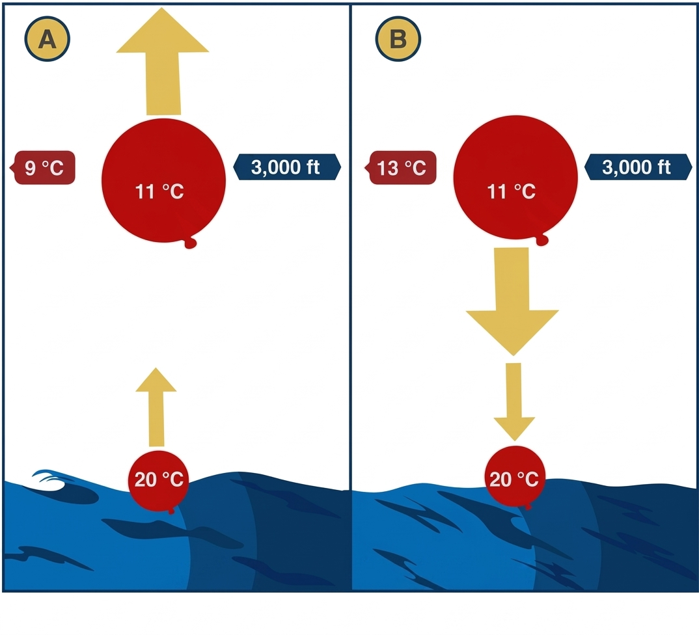
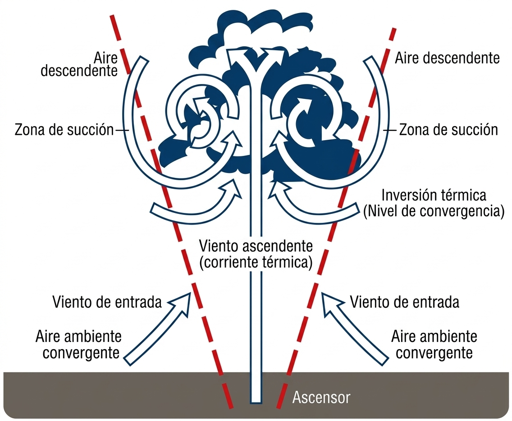
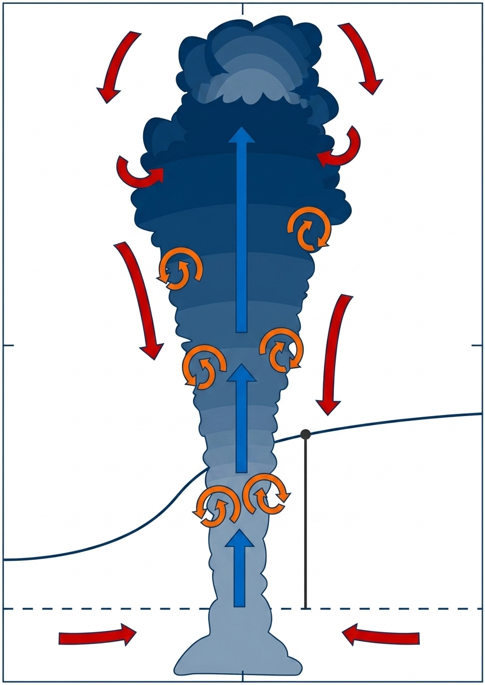
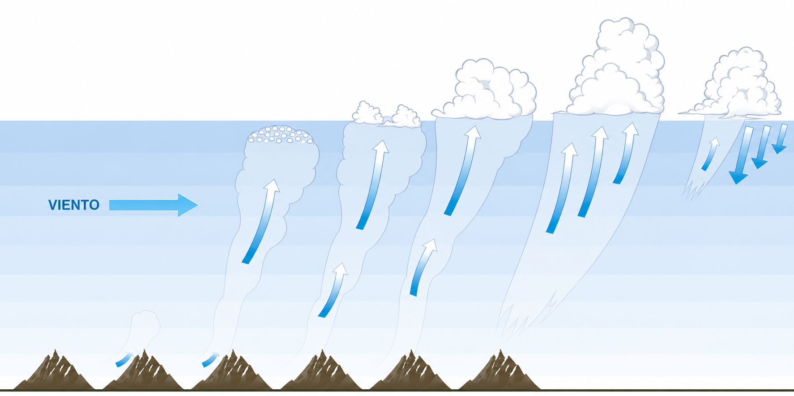

# Termodinámica

> La termodinámica es el motor invisible del vuelo sin motor: sin aire inestable no hay
> térmicas, y sin térmicas no hay vuelo de distancia. En este capítulo aprenderás a interpretar
> la estabilidad atmosférica, a calcular la base de los cúmulos con una operación mental sencilla,
> a reconocer una inversión térmica y a leer los índices de sondeo que predicen si el día será
> excelente o decepcionante para volar.

## Estabilidad atmosférica: el combustible del vuelo a vela

  La estabilidad de la atmósfera define cómo se comporta una masa de aire (una "burbuja" o parcela) cuando es empujada hacia arriba. El vuelo sin motor vive fundamentalmente de la inestabilidad (@fig-03-cap03-estabilidad).

Podemos entenderlo imaginando una pelota en diferentes relieves:

* **Atmósfera absolutamente estable**: Si empujas la pelota desde el fondo de un valle subiéndola por la ladera, volverá a caer al centro. En el aire, si el ambiente se enfría con la altura más despacio que el gradiente saturado (menos de 1,5 °C por cada 1.000 ft, unos 0,5 °C/100 m) —o se calienta, como en una inversión—, una burbuja que ascienda, seca o saturada, se enfriará más rápido que su entorno. Pronto estará más fría (y pesada) que el aire que la rodea, deteniendo su ascenso y hundiéndose de nuevo.
* **Atmósfera absolutamente inestable**: Imagina la pelota en equilibrio precario en la cima de un monte; un pequeño empujón hará que caiga rodando sin parar. Si el aire ambiental se enfría con la altura más deprisa que el gradiente seco (más de 3 °C por cada 1.000 ft, 1 °C/100 m), una burbuja que empiece a subir siempre se mantendrá más caliente (y ligera) que el aire a su alrededor, acelerando su ascenso. Esta es la condición ideal para la formación de fuertes térmicas.
* **Inestabilidad condicional**: El ambiente se enfría con la altura a un ritmo intermedio, entre el gradiente saturado y el seco. Entonces depende de la humedad: la burbuja seca se enfría más deprisa que su entorno y es estable; pero si se satura, el calor liberado por la condensación (al formar nubes) hace que se enfríe más despacio que el entorno y siga subiendo (inestable). Es la situación habitual de los días de cúmulos.

{#fig-03-cap03-estabilidad}

## Gradientes adiabáticos y la base de las nubes

   Cuando una burbuja de aire asciende impulsada por la convección, se expande a medida que encuentra menor presión atmosférica en altura. Esta expansión provoca que se enfríe de forma interna (proceso adiabático), sin intercambiar calor con el aire exterior. El ritmo al que se enfría depende de si el aire está seco o saturado de humedad.

* **Gradiente Adiabático Seco (DALR - *Dry Adiabatic Lapse Rate*)**: Mientras la burbuja no alcance el 100% de humedad, se enfría a un ritmo constante de **3 °C por cada 1.000 pies** (1 °C cada 100 metros).
* **Gradiente Adiabático Saturado (SALR - *Saturated Adiabatic Lapse Rate*)**: Cuando la burbuja se enfría lo suficiente como para alcanzar su punto de rocío, el vapor de agua comienza a condensarse, formando la base de una nube (Nivel de Condensación por Ascenso o NCA). La condensación libera calor latente dentro de la burbuja. Por tanto, a partir de la base de la nube, la burbuja sigue subiendo, pero se enfría mucho más despacio, típicamente a **1,5 °C por cada 1.000 pies** (0,5 °C cada 100 metros en niveles bajos).

::: {.callout-tip title="Regla de oro"}
Puedes estimar fácilmente la altura de la base de los cúmulos restando la temperatura del punto de rocío a la temperatura ambiente en el suelo. Como los dejas atrás a razón de unos 2,5 °C por cada 1.000 pies de ascenso conjunto (los 3 °C del DALR menos los 0,5 °C que baja el punto de rocío), la fórmula es: **$(T - T_{\text{rocío}}) \times 400$ = altura de la base sobre el aeródromo, en pies.** Para obtener la altitud, suma la elevación del aeródromo.
:::

Para aplicar la fórmula, sigue estos pasos antes de cada vuelo:

1. Anota la temperatura ambiente en tierra (T) y la temperatura del punto de rocío (T~rocío~) del METAR o la estación del aeródromo.
2. Calcula la diferencia: ΔT = T − T~rocío~.
3. Multiplica: ΔT × 400 = altura estimada de la base de los cúmulos sobre el aeródromo, en pies.

*Ejemplo: T = 26 °C, T~rocío~ = 16 °C → (26 − 16) × 400 = **4.000 ft** de base.* (véase @fig-03-cap03-base-cumulos-dalr-nca)

{#fig-03-cap03-base-cumulos-dalr-nca .corregir}

## Inversiones térmicas: la tapadera invisible

Normalmente la temperatura disminuye con la altitud, pero en ocasiones ocurre lo contrario: encontramos capas donde **la temperatura del aire aumenta a medida que subimos**. A esto se le llama una inversión térmica.

Una inversión térmica actúa como una tapadera o techo de cristal. Debido a que el aire por encima de la inversión está sorprendentemente caliente, cuando una térmica sube y choca contra esa capa, de repente se encuentra rodeada de aire más caliente (y por tanto más ligero) que ella misma. La térmica pierde su flotabilidad (**buoyancy**) instantáneamente, deteniendo en seco el ascenso.

::: {.callout-warning title="Seguridad"}
Las inversiones no solo limitan la altura máxima a la que puedes trepar en un planeador, frenando la convección por completo, sino que también atrapan humo, bruma y humedad industrial cerca de la superficie, reduciendo drásticamente la visibilidad en vuelo por debajo de la capa de inversión.
:::

## Convección: el transporte vertical de calor

La convección es el proceso por el cual el calor se transporta verticalmente en la atmósfera, y es el mecanismo exacto que forma las térmicas.

El sol no calienta el aire directamente, sino que calienta la superficie de la tierra. Este calentamiento es muy desigual: un campo arado oscuro, una zona rocosa o un pueblo de tejados secos se calentará mucho más rápido que un bosque denso o un lago. El suelo caliente calienta por contacto la capa de aire inmediatamente superior.

Ese aire caliente, ahora menos denso y más ligero, tiende a subir por flotabilidad, formando una corriente convectiva o "térmica". Inicialmente, la burbuja se agarra al terreno por la fricción, aumentando su empuje ascensional hasta que finalmente se desprende y comienza a subir.

::: {.callout-note title="Airmanship"}
Para encontrar las mejores térmicas, busca "fuentes" que se calienten rápido (suelos secos, campos cosechados, zonas rocosas al sol) y "disparadores" o puntos de ruptura que ayuden a la burbuja a desprenderse del suelo, como una cresta de una colina orientada al viento, o una línea de árboles al borde del campo soleado.
:::

Los meteorólogos distinguen dos modelos conceptuales de cómo se organiza internamente ese flujo vertical:

* **Modelo burbuja** (**bubble model**): El calor se acumula sobre la fuente hasta que la burbuja se desprende, como si tirases de un globo. El ascenso es intermitente: el núcleo central sube más rápido que los bordes, que presentan subsidencia. El planeador debe buscar y mantenerse en el núcleo para aprovechar el ascenso máximo (@fig-03-cap03-modelo-burbuja).

{#fig-03-cap03-modelo-burbuja .corregir}

* **Modelo columna o pluma** (**column/plume model**): En fuentes intensas y persistentes (una cantera, un pueblo grande, una ladera orientada al sol toda la mañana), el flujo convectivo es continuo, como el humo de una chimenea. El ascenso es más regular y predecible, ideal para el vuelo de distancia (@fig-03-cap03-modelo-columna).

{#fig-03-cap03-modelo-columna .corregir}

En los días reales coexisten ambas estructuras. Las primeras horas de la mañana tienden a producir burbujas aisladas; a medida que el calentamiento se consolida, pueden aparecer columnas duraderas. Reconocer cuál predomina ese día mejora el centrado de térmicas y reduce el tiempo perdido fuera de círculo (@fig-03-cap03-ciclo-vida-termica).

{#fig-03-cap03-ciclo-vida-termica}

::: {.mas-alla}
## Índices de estabilidad: el termómetro del día

[**↗ MÁS ALLÁ DEL EXAMEN.**]{.mas-alla-tag} Los índices de sondeo (TT, K, CAPE, LI) y los Skew-T no deberían ser materia de examen: son formación de vuelo de distancia. Estúdialos cuando domines el resto del temario; aquí están porque forman al piloto, no solo al aprobado.

Describir cualitativamente la atmósfera ("parece inestable", "hace buena cara") es útil, pero los pilotos de cross-country van un paso más allá: cuantifican la inestabilidad mediante índices derivados de los sondeos termodinámicos.

El instructor de vuelo experimentado maneja habitualmente dos parejas de índices:

* **TT + K** como herramientas del día a día para decidir si vuelas y qué puedes esperar.
* **CAPE + LI** como herramientas de análisis profundo cuando el día "tiene trampa".

Los dos índices usan el nivel de 850 hPa, unos 1.500 m. En montaña ese nivel puede quedar cerca del suelo o por debajo de él, y entonces ninguno de los dos es representativo: el manual de referencia del K advierte que no se calcula de forma fiable en estaciones de montaña. Úsalos juntos y contrástalos con el sondeo completo.

### Total Totals (TT)

El índice Total Totals (TT) combina el gradiente vertical de temperatura con la humedad en capas bajas. Su fórmula, con la temperatura (T) y el punto de rocío (Td) en °C a cada nivel de presión (hPa):

$$\text{TT} = (T_{850} + \text{Td}_{850}) - 2\,T_{500}$$

::: {.callout-note title="Airmanship"}
El gráfico TT + K que el instructor cuelga cada mañana en el hangar te da la fotografía rápida del día. El TT y el K miden, con fórmulas distintas, cuánto "combustible" tiene la atmósfera para armar un Cb. No confíes en uno solo: úsalos juntos antes de cada preflight.
:::

Umbrales del TT y su interpretación para el vuelo a vela:

| TT | Condición para el vuelo a vela |
| --- | --- |
| < 44 | Atmósfera estable; térmicas débiles o inexistentes |
| 44–47 | Inestabilidad moderada; convección posible, tormenta poco probable |
| 48 | Tormentas aisladas o escasas |
| 52 | Tormentas dispersas, alguna moderada |
| 55 | Tormentas dispersas, algunas moderadas y alguna aislada severa |
| 58 | Tormentas dispersas, algunas severas y algún tornado aislado |
| 61 | Tormentas dispersas a frecuentes, algunas severas y algún tornado |
| 64 | Tormentas frecuentes, severas dispersas y tornados dispersos |
: Umbrales del Total Totals (TT) y su interpretación

Los umbrales de tormenta de la tabla, de 48 en adelante, son la escala del oeste de Estados Unidos que recoge el manual del Air Weather Service sobre el diagrama Skew-T (AWS/TR-79/006, revisión de 1990), tomada del servicio meteorológico de esa región (1984). La escala clásica de Robert C. Miller (1972), pensada para el este de Estados Unidos, es más baja: espera tormentas aisladas desde un TT de 44. Los umbrales del TT cambian mucho de una región a otra y no hay una calibración publicada para la Península; las dos primeras filas son una adaptación operativa de esta colección.

::: {.callout-warning title="Seguridad"}
El TT presenta limitaciones: sobrestima la inestabilidad si la temperatura a 500 hPa es muy baja sin soporte convectivo en capas bajas, y no detecta bien la estabilidad fuerte o la humedad elevada por debajo de 850 hPa. En esas situaciones, refuerza el análisis con el K-Index y el CAPE.
:::

### K-Index

El K-Index combina el gradiente de temperatura entre 850 hPa y 500 hPa con la humedad en niveles medios y bajos:

$$\text{K} = (T_{850} - T_{500}) + \text{Td}_{850} - (T_{700} - \text{Td}_{700})$$

Se diseñó para pronosticar las tormentas de masa de aire. Sus umbrales:

| K | Condición para el vuelo a vela |
| --- | --- |
| < -10 | Térmicas inexistentes o muy débiles (atmósfera muy estable) |
| -10 a 5 | Térmicas secas sin cúmulos; convección escasa |
| 5–15 | Buenas condiciones de vuelo a vela, cúmulos presentes |
| 15–20 | Excelente: bases altas, térmicas potentes, chubascos ocasionales |
| 20–30 | Excelente convección, pero riesgo creciente de chubascos y tormentas |
| > 30 | Alta probabilidad de tormentas (> 60 %): no planifiques vuelos largos |
: Umbrales del K-Index y su interpretación

Las bandas altas de la tabla concuerdan con la escala clásica de George de probabilidad de tormenta de masa de aire (15–20 ≈ 20 %, 21–30 ≈ 20–60 %, 31–35 ≈ 60–80 %). Las tres primeras filas, en cambio, son una adaptación operativa de esta colección: por debajo de 15 la escala meteorológica no distingue nada, porque sólo pronostica tormentas, y para el volovelista ahí está justo la diferencia entre un día sin térmica y un buen día.

::: {.callout-note title="Airmanship"}
El K-Index fue diseñado para predecir tormentas, no la calidad del vuelo a vela. Sus umbrales varían según la región y la estación: en zonas áridas como la Meseta Central, la baja humedad puede dar K bajos incluso con térmicas potentes. En montaña, si el nivel de 850 hPa queda cerca del suelo, el índice pierde representatividad. Úsalo siempre junto al TT y, si el día tiene pinta de complicarse, añade el CAPE.
:::

### CAPE y LI: profundizando cuando el día tiene trampa

* **CAPE** (**Convective Available Potential Energy**, Energía Potencial Convectiva Disponible): Cuantifica la energía disponible para la convección. Es el área entre la curva de la parcela y la curva de estado en el diagrama termodinámico. Valores de referencia: 0 J/kg = estabilidad absoluta; 1.000–2.500 J/kg = térmicas potentes, aunque no descarta la tormenta; > 3.500 J/kg = convección severa probable.

::: {.callout-note title="Airmanship"}
Los valores de CAPE que ves en manuales de meteorología general suelen clasificar 1.000–2.500 J/kg como "moderadamente inestable", reservando "muy inestable" para valores superiores. Para el volovelista, ese rango puede dar térmicas potentes y bases altas, pero también tormentas si hay humedad y disparo: el CAPE por sí solo no descarta la tormenta. Cuando consultes herramientas externas como Skysight o la Universidad de Wyoming, lee el CAPE junto con los otros índices, la humedad y la previsión de nubosidad, nunca como un valor aislado.
:::

* **LI (Índice de Levantamiento o *Lifted Index*)**: Diferencia entre la temperatura del ambiente y la de la parcela a 500 hPa, tras elevar la parcela adiabáticamente desde el suelo. Valores negativos indican inestabilidad: cuanto más negativo, mayor el potencial convectivo.

::: {.callout-tip title="Regla de oro"}
Día de convección excepcional — conocido coloquialmente como «día termonuclear» en el argot de competición —: TT entre 44 y 48, K entre 15 y 20, CAPE entre 1.000 y 2.500 J/kg, LI negativo y vientos flojos de componente variable. Son los días de récords de distancia, pero la misma firma puede acabar en tormenta si la humedad y el disparo acompañan: vigila el sobredesarrollo. Puedes encontrar todos estos índices en cualquier sondeo online: gratuitamente en la Universidad de Wyoming, AEMET (AMA), Windy o Meteoblue; con previsiones orientadas al planeador en Skysight, Topmeteo o Meteo Parapente.
:::

Las tablas de umbrales de los apartados anteriores (ocho tramos la del TT y seis la del K) describen todo el espectro, de la calma a la tormenta severa. La tabla siguiente resume la banda útil de cada índice; las tablas completas son material de campo para cuando vueles de verdad:

| Índice | Banda de buen día térmico | Señal de alarma (tormenta) |
| --- | --- | --- |
| **TT** (Total Totals) | 44–47 | 48 o más |
| **K** (K-Index) | 5–20 | > 25 (de 20 a 25, vigila) |
| **CAPE** | 1.000–2.500 J/kg (no descarta la tormenta) | > 2.500 J/kg |
| **LI** (Lifted Index) | ligeramente negativo | muy negativo |
: Los cuatro índices de sondeo: bandas de referencia para el vuelo a vela

La regla de oro para la cabina: un índice aislado no decide nada. TT y K dicen si el día vuela; CAPE y LI, cuánta energía tiene y si esa energía puede volverse contra ti en forma de tormenta.

::: {.callout-warning title="Seguridad"}
TT de 52 o más o K > 25, combinado con CAPE > 2.500 J/kg, señala alto riesgo de tormenta de evolución diurna. En estas condiciones, planifica el aterrizaje antes de las 16:00 h y ten siempre identificado un campo de aterrizaje alternativo en tierra antes de que se levante la convección.
:::
:::

::: {.postit}
**Resumen del capítulo: termodinámica**

* **Estabilidad Atmosférica**: Concepto clave. El aire es "estable" si una burbuja empujada hacia arriba tiende a volver a bajar, e "inestable" si sigue subiendo sola. El vuelo a vela vive de la inestabilidad.
* **Gradientes Adiabáticos**: El aire seco se enfría 3°C por cada 1.000 ft al subir (DALR). El aire saturado (nube) se enfría más despacio: unos 1,5°C cerca de la superficie en aire templado, más con el frío y la altura (SALR). Memoriza esto para predecir la base de las nubes y su desarrollo.
* **Base de los cúmulos**: (T − T~rocío~) × 400 = altura de la base sobre el aeródromo, en pies. Sale de que la burbuja se enfría 3 °C por cada 1.000 ft y su punto de rocío sólo 0,5 °C: se acercan 2,5 °C por cada 1.000 ft.
* **Inversiones**: Son capas donde la temperatura **sube** con la altura en lugar de bajar. Actúan como una tapadera invisible que frena las térmicas y atrapa la contaminación/bruma.
* **Convección**: El sol calienta el suelo, el suelo calienta el aire, y este sube como una burbuja (modelo burbuja) o como una pluma continua (modelo columna). Cuanto más frío esté el aire arriba en comparación con el suelo, más fuerte será la térmica.
:::
