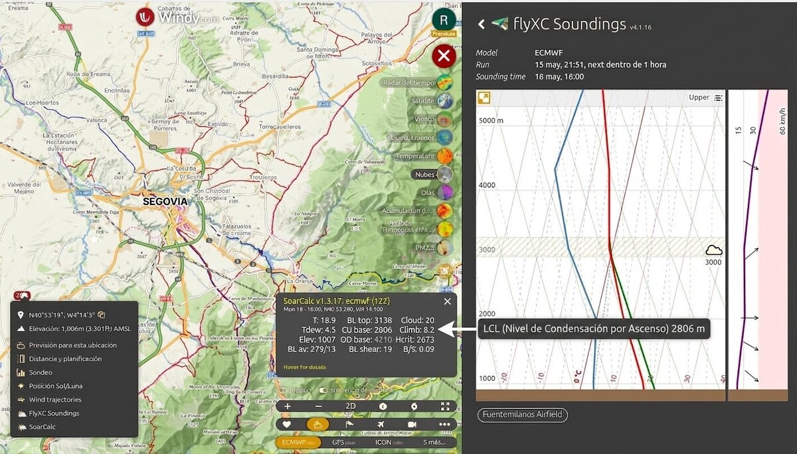

# Meteorological information

> Knowing how to fly is necessary; knowing how to read the weather before you take off is
> essential. In this chapter you will learn to interpret METARs, TAFs, SIGWX charts and
> thermodynamic soundings as they apply to gliding: from deciphering a four-letter code
> to deciding, with sound judgement, whether the day is worth getting the glider out of the hangar.

## METAR and TAF reports

Soaring depends so heavily on the atmosphere that reading aeronautical weather information accurately is a basic requirement before any flight. The main standard reports are the METAR and the TAF:

* **METAR (Meteorological Aerodrome Report):** an observation of the actual, current weather at the aerodrome. It is usually issued every 30 minutes (or every 60 minutes, depending on the aerodrome). It gives concise data on surface wind direction and speed, horizontal visibility, cloud (amount and base height), air temperature, dew point and altimeter setting (QNH). The message often ends with a short-term `TREND` forecast valid for the next 2 hours (or `NOSIG` if no significant change is expected).
* **SPECI (Special Aerodrome Report):** the urgent sibling of the METAR. It is issued outside the regular cycle when conditions change significantly, for the worse or for the better: visibility or the base or amount of cloud crosses an operational threshold, a thunderstorm or precipitation starts or stops. In Spain it is not issued for changes in the wind, except under local criteria, nor while the station is working in automatic mode. Its format is identical to the METAR; only the first word changes. When you check an aerodrome, always look at the time of each report: the one in force is the most recent, whether METAR or SPECI.
* **TAF (Terminal Aerodrome Forecast):** the official aerodrome forecast. Prepared by meteorological offices, it forecasts how the weather at the aerodrome will develop over standard validity periods of 9, 24 or 30 hours (in Spain, only 24 or 30 hours, renewed every 6 hours). It uses change and probability groups that are essential for planning:
  * `FM` (**from**): a rapid, permanent change from the time given. Everything before it no longer applies.
  * `BECMG` (**becoming**): a gradual, permanent change within the period given.
  * `TEMPO`: temporary fluctuations, each lasting less than an hour and together less than half the period.
  * `PROB30` and `PROB40`: a 30 % or 40 % probability of what follows. **These are the only two that exist**: if the probability reaches 50 %, the phenomenon is coded as a change (`BECMG` or `FM`), and below 30 % it is not coded at all.

You must be fluent in this code. The indicators that matter most in practice include:

* CAVOK: indicates ideal VFR conditions, and requires four things **at the same time**: horizontal visibility of 10 km or more; no cloud below 5,000 ft or the highest minimum sector altitude, whichever is greater; **no Cb or TCU at any level**; and no significant weather. That “at any level” is often overlooked: a cumulonimbus with its base at 7,000 ft rules out CAVOK even though it is well above the 5,000 ft threshold. The label is the ICAO one; around the club you will hear the backronym *Ceiling And Visibility OK*, which is not the official name.
* NSC (No Significant Cloud): no cloud below 5,000 ft (or the highest minimum sector altitude, whichever is greater) and no Cb or TCU, when the CAVOK criteria are not met, typically because visibility is below 10 km.
* NCD (**No Cloud Detected**) and SKC (**Sky Clear**): often confused with NSC, but they mean different things. `NSC` does not say there is no cloud: it says none is operationally significant, and it is what a human observer writes when the sky is clear (or `CAVOK`, if all its conditions are met). `NCD` is reported only by an **automatic** station whose sensors have detected no cloud. `SKC` is a US code that does not appear in European METARs.
* Reduced visibility: abbreviations such as `FG` (**Fog**) or `BR` (**Mist**) indicate marginal or restrictive VFR conditions and can hold up take-offs for a while.

Cloud cover is coded in **eighths of the sky covered**, or oktas, and there are four steps, not two:

| Code | Oktas | Meaning |
| --- | --- | --- |
| `FEW` (**Few**) | 1–2 | Few |
| `SCT` (**Scattered**) | 3–4 | Scattered |
| `BKN` (**Broken**) | 5–7 | Broken |
| `OVC` (**Overcast**) | 8 | Overcast |
: Cloud cover in oktas, as coded in METAR and TAF {#tbl-03-cap10-octas}

Note the jump in @tbl-03-cap10-octas between `SCT` and `BKN`. There, in a single eighth of sky, lies the difference between a day of usable cumulus and a sky that closes in and switches the thermals off.

::: {.callout-important title="Regulation"}
In written METARs and TAFs, the wind direction is given relative to **true north**. The wind that the Tower or the ATIS gives you by radio is relative to **magnetic north**, like the runway numbers, so that you can compare it directly with the runway heading without correcting anything. It is the same figure measured against two different norths, and it is often confused. The Communications book covers it in detail.
:::

### A worked example of METAR decoding

The message arrives in one piece. The first step is to **split it into groups** and read each one on its own. Here is the one we will decode:

```
METAR LEMD 241100Z 18002KT 9999 FEW028 OVC040 16/09 Q1019 NOSIG=
```

Group by group:

* **METAR**: type of report (routine observation).
* **LEMD**: aerodrome (in this case, Madrid-Barajas).
* **241100Z**: day 24 of the month, at 11:00 UTC (Zulu time).
* **18002KT**: wind from 180° (south), relative to true north, at 2 knots.
* **9999**: horizontal visibility of 10 km or more (excellent).
* **FEW028**: few clouds (**Few**, 1 to 2 oktas) with a base 2,800 feet above aerodrome elevation.
* **OVC040**: overcast (**Overcast**, 8 oktas) at 4,000 feet.
* **16/09**: air temperature 16 °C and dew point 9 °C. (Apply the golden rule from the thermodynamics chapter: (16 − 9) × 400 = 2,800 feet, a perfect match for the cloud reported at 2,800 feet.)
* **Q1019**: altimeter setting (QNH) of 1019 hPa.
* **NOSIG**: TREND forecast indicating that **no** **sig**nificant changes are expected in the next 2 hours. The `=` marks the end of the message.

Decoding is the easy part. Deciding is harder. This METAR is a **no-go** for soaring, and a single word says so: `OVC040`. With overcast at 4,000 feet no sun reaches the ground, and without sun there is no differential heating, no thermals and no flying. It does not matter that the visibility is excellent, the wind light and the QNH comfortable. And notice how close the two came: `FEW028` matched the golden rule and promised cumulus at 2,800 feet, and the layer covering them is only 1,200 feet higher. Get into the habit of asking yourself, group by group, what each one does to the day.

Other groups that turn up every day and are not in this example:

* **Wind**: `G` marks the gust (`18012G25KT`, 12 knots gusting 25); `VRB` means variable direction; and two headings joined by `V` (`180V240`) give the range over which the direction varies.
* **Visibility and cloud**: `VVnnn` is vertical visibility (the sky cannot be seen, so the measurement is made upwards through the fog), and `VV///` means it could not be determined; `NSW` (**No Significant Weather**) is used in the TAF and the TREND to announce the expected end of a significant phenomenon.
* **Weather**: `RE` prefixes recent weather (`RETS`, recent thunderstorm); `WS` warns of wind shear (`WS R18`).
* **Below-zero temperature**: marked with `M` (`M02/M05` is −2 °C and −5 °C).
* **Pressure**: `Q1019` is in hectopascals; `A2992` is in inches of mercury, the United States format.
* **Source and corrections**: `AUTO` means the report comes from an automatic station (in Spain, some are supervised on site); `COR` is a corrected report and `AMD` an amended TAF.

| Aspect | METAR | TAF |
| --- | --- | --- |
| Type | Actual observation (current state of the aerodrome) | Official forecast (expected development) |
| Issue frequency | Every 30 min (or 60 min at smaller aerodromes) | In Spain, every 6 h (the 24 h and 30 h ones) |
| Validity period | A single moment + 2-hour TREND | 9, 24 or 30 hours; in Spain, 24 or 30 |
| Issued by | Observer or automatic station at the aerodrome | Meteorological office (AEMET) |
| Main use | Checking conditions at take-off or on arrival | Planning the flight in advance |
| Key indicators | `CAVOK`, `NSC`, `FG`, `BR`, `NOSIG` | `FM`, `BECMG`, `TEMPO`, `PROB30`, `PROB40` |
: METAR vs TAF: key differences for flight planning {#tbl-03-cap10-metar-taf}

In @tbl-03-cap10-metar-taf, the issue frequency depends on the validity: the short TAF is refreshed often and the long one rarely. A 24-hour TAF issued five hours ago may be well out of date and still be the one in force.

## Significant weather charts (SIGWX)

While METAR and TAF cover specific airports, **Significant Weather Charts (SIGWX)** show the expected weather over large en-route areas. They are the bird's-eye view of planning: they tell you where the fronts are, which areas of instability you should go round and where the freezing levels lie (@fig-03-cap10-sigwx).

* SIGWX charts show the distribution of fronts (cold, warm, stationary, occluded) and pressure systems, with their forecast movement.
* They identify axes of instability such as **troughs**, which come before the development of cumulus and showers.

The same services also issue specific warnings. They are easy to confuse; the difference is the level they cover:

* **SIGMET** (**Significant Meteorological Information**): phenomena hazardous to any aircraft, **at any level** and throughout the FIR: severe icing (`SEV ICE`), severe turbulence (`SEV TURB`), embedded cumulonimbus, volcanic ash. Most of these phenomena live above FL100, but the warning still concerns you: the Cb whose top justifies the SIGMET has its base at your height.
* **AIRMET** (**Airmen's Meteorological Information**): phenomena less severe than those in a SIGMET, **below FL100** (FL150 in mountainous areas, or higher if needed) under the European rule. In Spain, AEMET issues it for the whole FIR up to **FL150**. This is the one made to measure for us.
* **GAMET** (**General Area Meteorological Forecast**): an area forecast in abbreviated plain language for low levels (in Spain, up to FL150, like the low-level SIGWX chart), not a one-off warning.

Before a cross-country flight you must study the available reports and forecasts (SERA.2010(b)), and that includes the active SIGMETs and AIRMETs.

{#fig-03-cap10-sigwx .corregir}

## Radar, satellite and weather charts

The coded reports are completed by images and charts that AEMET publishes and that you should be able to read:

* **Weather radar**: it detects precipitation and its intensity (the echoes), and with successive images you can see where and how fast showers and thunderstorms are moving. It does not see cloud without precipitation or dry thermals.
* **Satellite images**: the visible channel shows clouds as the eye would see them, and only by day; the infrared channel shows them by their temperature, day and night: the whiter, the colder and higher the top, so Cb stand out as very white, rounded blobs.
* **Surface and upper-air charts**: the surface chart draws the isobars, the pressure centres and the fronts, and is the basis of the analysis in chapter 7; upper-air charts, such as the 500 hPa chart, show the troughs and cut-off lows (DANA) that trigger instability.

::: {.mas-alla}
## Thermodynamic soundings and temperature curves

[**↗ BEYOND THE EXAM.**]{.mas-alla-tag} Skew-T soundings and the indices calculated from them (K, CAPE, LI) belong to cross-country training and should not be exam material. Read them as an introduction to cross-country flying.

The thermodynamic sounding is the X-ray of the day: it shows how temperature and humidity change with height at a given place. It is plotted on **Skew-T log-P** or **Stüve** diagrams, and the tools that publish it (free and paid, general and gliding-specific) are listed with their addresses in the “Weather Sources for Soaring” appendix of this book. Learning to read a sounding will save you unnecessary tows and warns you of thunderstorms before they can be seen from the ground (@fig-03-cap10-indices-estabilidad).

{#fig-03-cap10-indices-estabilidad}

* The blue line shows the dew point
* the red line shows the air temperature
* the green line shows the temperature of a rising parcel
* the hatched area along the plot shows the cloud layer (the cumulus)
* the wind plot shows wind from 0–30 km/h on the left (white background) and from 30 up to the maximum speed on the right (red background)

The three key readings are:

1. **Cumulus base (LCL):** watch out for a common mistake. Where the temperature and dew point curves touch is **not** the LCL but a layer that is already saturated: fog, stratus or a cloud that exists at that moment. The LCL comes from crossing two different lines: from the surface temperature you go up along the **dry adiabat**, from the surface dew point you go up along the **saturation mixing ratio line**, and where they cross is the height at which the parcel condenses. It is the same calculation as the golden rule in the thermodynamics chapter ((T − T~dew~) × 400 is its arithmetic approximation), so the sounding and the rule of thumb should give you the same answer; if not, you have misread one of them. For the day you are going to fly, do the construction with the **forecast maximum temperature** instead of the current one: what you then get is the forecast base of the afternoon cumulus, close to the convective condensation level (CCL). The thermal ceiling is plotted on the same basis.
2. **Thermal ceiling:** draw the dry adiabat from the forecast maximum temperature. Where that line crosses the environment curve again is the top of the thermals. The quality of the day lies in **how far it is from the base**: if the ceiling is well above the LCL, the convective layer is deep and the thermals will be strong; if the two almost coincide, thermal flying will be weak and short.
3. **Risk of overdevelopment (Cb):** if the environment curve becomes very unstable above the **Level of Free Convection** (LFC), the height above which the parcel rises on its own without anything pushing it, the midday cumulus may turn into cumulonimbus in the afternoon. CAPE quantifies that available energy: above 2,500 J/kg convection is vigorous and you need to watch the sky, and above 3,500 J/kg severe convection is likely. Combined with a K-Index above 25, it is the signature of a day that may end badly.

Those two numbers always go **as a pair**. You get cumulus when the LCL is below the thermal ceiling, because the parcel condenses before it stops rising; and you get blue thermals, without a single cloud to show you where the air is rising, when it is above. An LCL at 3,000 m with the ceiling at 4,000 gives cloud streets and a magnificent day; an LCL at 1,200 m with the ceiling at 1,100 gives a blue day. The height of the LCL on its own tells you nothing.

::: {.callout-tip title="Golden rule"}
An exceptional convection day (known informally in competition slang as a “thermonuclear day”) has a precise numerical signature: K-Index between 15 and 20, CAPE between 1,000 and 2,500 J/kg, negative LI, temperature at 850 hPa several degrees above **its climatological average for the date**, and light winds. That same signature does not rule out a thunderstorm if there is moisture and a trigger: watch for overdevelopment. Be careful with the 850 hPa figure, which is easily misremembered: it is compared with the climatology, not with the surface. At 850 hPa (about 1,500 m) the air on a normal day is between 5 and 15 °C **below** the ground temperature, depending on the airfield's altitude; if it were above, that would mean a massive inversion, in other words the day on which there is not a single thermal. Look for these indices directly in the day's sounding, in any of the sources in the appendix.
:::
:::


## Analysing the data and making decisions

Before you go out to the launch point, studying the available reports and forecasts is mandatory (SERA.2010(b)); cross-checking several sources is prudent. Do not trust a single model or a single parameter.

* **Compare what you see with what the model forecasts:** if you arrive at the field and cloud is already covering the sunny slope when the sounding promised thermals until 3 in the afternoon, something has gone wrong. Reality rules: cancel or wait.
* **The pilot-in-command's judgement:** the last word is always yours, not the model's. Cross-check at least two independent sources from those listed in the appendix (one general and one aimed at soaring), check the METAR and TAF for your home aerodrome and for nearby alternates, see whether there is a recent SPECI, and note the K and CAPE indices from the day's sounding. But remember: no favourable forecast on paper carries more weight than what you see at the launch point.

::: {.callout-note title="Airmanship"}
AEMET (*Agencia Estatal de Meteorología*, the Spanish State Meteorological Agency) and its aeronautical platform AMA (**Autoservicio Meteorológico Aeronáutico**, the aeronautical weather self-briefing service) are the official source for your pre-flight planning: AEMET is the aeronautical meteorological authority and the designated service provider. METAR, SPECI, TAF, SIGMET and AIRMET come from there. NOTAMs do not come from there: they are published by the aeronautical information service (AIS; in Spain, ENAIRE), and those that carry weather information (SNOWTAM for runway condition, ASHTAM for volcanic ash) draw on AEMET data but are issued through the AIS. The general and gliding-specific platforms listed in the appendix are mentioned in this manual because they are part of everyday operational reality, but they must never replace the official safety weather briefing.
:::

::: {.callout-warning title="Safety"}
If the actual weather at the launch point differs from a favourable forecast (unexpected low cloud, strong variable wind, thick haze), what you see always wins. A cancelled flight has never been an accident. A **no-go** culture is not cowardice: it is the judgement that marks a mature pilot.
:::

::: {.postit}
**Chapter summary: meteorological information**

* **METAR, SPECI and TAF**: your essential reports. METAR = current snapshot (every 30 min); SPECI = urgent snapshot, outside the cycle, because something has changed; TAF = forecast (in Spain, for 24 or 30 h). Learn to decode them fluently (CAVOK means visibility ≥ 10 km, no cloud below 5,000 ft and no Cb or TCU **at any level**; FG means fog; BR mist; oktas go FEW 1–2, SCT 3–4, BKN 5–7, OVC 8).
* **Significant weather charts (SIGWX)**: they show fronts and areas of turbulence and icing. Crucial for planning long routes. Warnings differ by level: SIGMET at any level, AIRMET at low levels (in Spain, up to FL150).
* **Decision-making**: do not trust a single source. Cross-check: METAR and TAF for the field and the alternates + SIGWX + the day's sounding + what you see at the launch point. If the weather looks doubtful, the best flight is the one that stays on the ground (no-go).
:::
